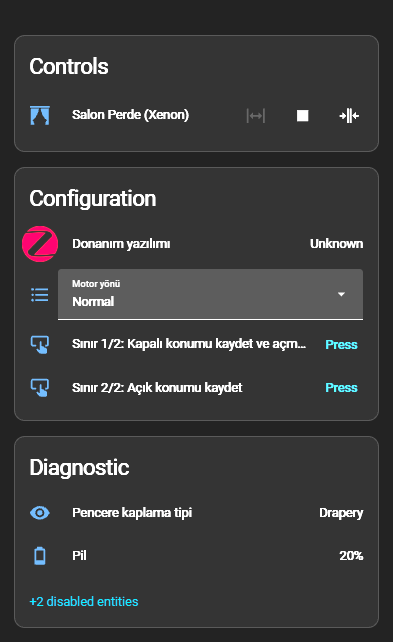
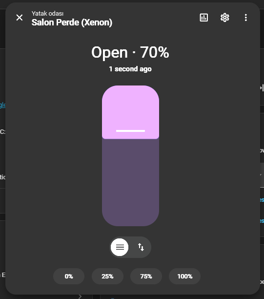

# ZHA quirk: Xenon Smart X7726 (Tuya TS0601) Zigbee curtain motor

A custom [ZHA quirk](https://github.com/zigpy/zha-device-handlers) for the **Xenon Smart X7726** curtain motor
(Tuya `TS0601`, manufacturer `_TZE284_hbjwgkdh`). I could not find a quirk for this device, and without one it
joins ZHA but gives no usable `cover` entity. With this quirk you get:

- a working `cover` entity: open / close / stop / set position %
- **motor direction** as a select entity (Configuration section)
- **limit (end-stop) learning** as two buttons (Configuration section), so the closed/open limits can be set
  entirely from Home Assistant
- a **battery** sensor

> **Status:** used daily on a real curtain for 1+ week. Limits, position %, stopping at the target % and
> Zigbee signal were all stable. Tested only on the hardware listed below. Reports from other variants are welcome.

| Configuration section | Cover dialog |
|---|---|
|  |  |

_The screenshot was taken with my local copy, whose entity names are in Turkish. The published file uses English names._

## Tested setup

| Item | Value |
|---|---|
| Device | Xenon Smart X7726 |
| Zigbee model / manufacturer | `TS0601` / `_TZE284_hbjwgkdh` |
| Coordinator | Sonoff Zigbee 3.0 Dongle Plus MG24 |
| Integration | ZHA |
| Home Assistant / ZHA version | _fill in_ |

If your motor reports a different `_TZE...` manufacturer string it may work too: add the string to the
`QuirkBuilder(...)` call at the bottom of the file and please report back.

## Installation

1. Enable custom quirks in `configuration.yaml`:
   ```yaml
   zha:
     custom_quirks_path: /config/custom_zha_quirks/
   ```
2. Copy [`ts0601_curtain.py`](ts0601_curtain.py) into `/config/custom_zha_quirks/`.
3. Restart Home Assistant.
4. If the motor was already paired, remove and re-pair it (or use **Reconfigure device**) so the quirk is applied.

Optional debug logging:
```yaml
logger:
  default: warning
  logs:
    zhaquirks: debug
    zigpy: debug
```

## Entities

| Entity | Type | Purpose |
|---|---|---|
| Cover | `cover` | Open / Close / Stop / Set position |
| Motor direction | `select` (`Normal` / `Reversed`) | Reverses the motor rotation direction |
| Limit 1/2: Save closed position and start opening | `button` | Saves the current spot as the closed limit and starts the motor moving in the open direction |
| Limit 2/2: Save open position | `button` | Saves the current spot as the open limit |
| Battery | `sensor` | Battery level |

## Setting the limits

1. Bring the curtain (by hand or with the motor's own buttons) to the position you want as **fully closed**.
2. Press **Limit 1/2**. The closed position is saved and the motor starts moving in the open direction.
3. When the curtain reaches the position you want as **fully open**, press **Limit 2/2**.
4. Test open, close and 50 %.

Notes:
- The motor's own stop button does **not** save the limit during learning. Only the "2/2" button does.
- If the direction is wrong, change **Motor direction** first, then redo the limits.

## Tuya datapoints

Used through ZHA's Tuya cluster (`0xEF00`).

| DP | Attribute in quirk | Meaning | Notes |
|---|---|---|---|
| 1 | `control` | Control command | `0` = open, `1` = stop, `2` = close |
| 2 | `percent_control` | Target position (write) | 0 = open, 100 = closed (same direction as ZCL) |
| 3 | `current_position_lift_percentage` | Current position (report) | |
| 13 | `battery_percentage_remaining` | Battery | raw value is multiplied by 2 for ZCL |
| 101 | `dp_101` | Motor direction | `0` = Normal, `1` = Reversed |
| 102 | `dp_102` | Limit learning | `0` = start (motor runs in the open direction), `1` = stop and save |
| 103 | `dp_103` | Unknown | Looks like a measurement (values around 24-26 seen), not a setting |
| 104-106 | `dp_104` … `dp_106` | Unknown | Reported, not tested |

DP 108 (7 zero bytes) also showed up in my logs but is not mapped.

### Warning: DP102

Writing DP102 outside the intended sequence can leave the motor only twitching on open/close.
What recovered mine: write `0` (the motor spins for about 17-18 s), then write `1` to stop.
After that open/close ran the full travel again. Use the two buttons rather than writing the DP by hand.

## Troubleshooting

- **No cover entity, or device unavailable after adding the quirk:** check the HA log for quirk import errors,
  restore the last working file and restart.
- **Open/close only twitches:** see the DP102 warning above.
- **Weak signal:** battery motors depend on a nearby mains-powered Zigbee router.

## Contributing

Issues and PRs are welcome, especially for other `_TZE...` variants and for identifying DP 103-106.

## License

_Add a LICENSE file (for example MIT) and name it here._

## Credits

Built and tested interactively in Home Assistant using ZHA debug logs, on top of the Tuya MCU helpers in
[zha-device-handlers](https://github.com/zigpy/zha-device-handlers).
